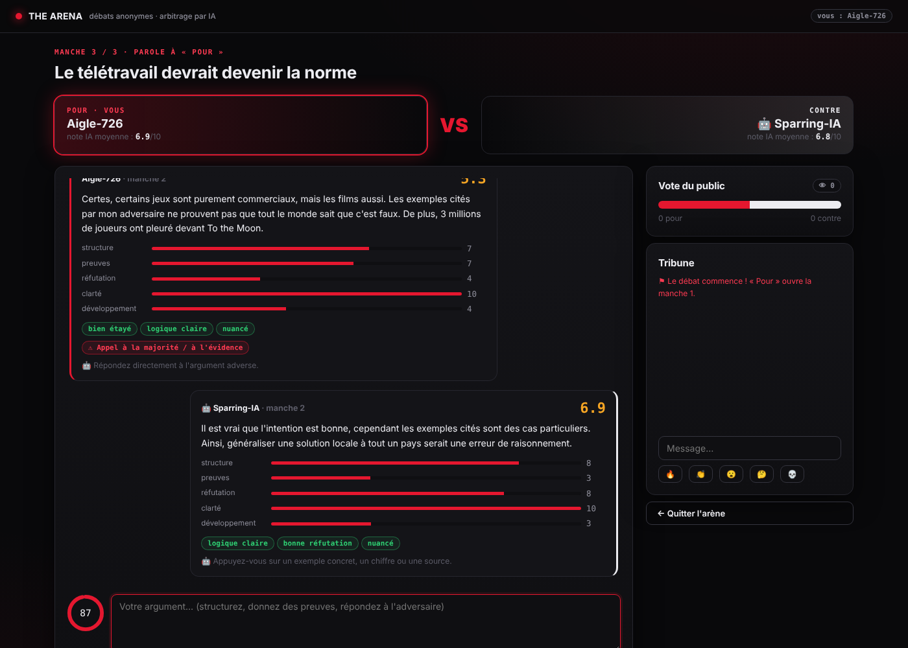
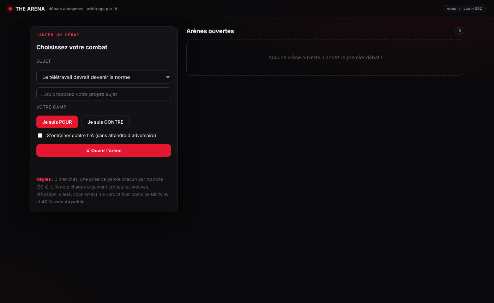

# ⚔ The Arena

> Débats anonymes en face-à-face : le public vote en direct et une IA analyse la qualité de chaque argument.




## Déroulement
1. Un joueur ouvre une arène sur un sujet (liste ou sujet libre) et choisit son camp, **POUR** ou **CONTRE**.
2. Le premier qui rejoint le camp adverse lance le débat. On peut aussi **s'entraîner contre l'IA**.
3. **3 manches**, une prise de parole de 90 s par camp et par manche, avec un chronomètre circulaire.
4. Les spectateurs **votent en direct** (vote modifiable), discutent dans la tribune et envoient des réactions animées.
5. **Verdict** = 60 % note de l'IA + 40 % vote du public. Abandon = forfait.

## L'arbitre IA (`analyzer.js`)
Chaque argument est noté sur 10 selon cinq critères, avec un conseil personnalisé :
| Critère | Ce qui est mesuré |
|---|---|
| Structure | connecteurs logiques (« parce que », « donc », « de plus »…) et nombre d'idées |
| Preuves | chiffres, sources, études, exemples concrets |
| Réfutation | reprise des termes de l'adversaire, concessions (« certes », « il est vrai ») |
| Clarté | longueur des phrases, majuscules et points d'exclamation à répétition |
| Développement | quantité d'argumentation |

**Sophismes détectés** (pénalités) : attaque personnelle, appel à la majorité, généralisation, pente glissante, faux dilemme, appel à la tradition.

## Technique
- Serveur **Node.js sans aucune dépendance** : `ws-lite.js` implémente le protocole WebSocket (RFC 6455 : handshake, trames masquées, fragmentation, ping/pong) et sert les fichiers statiques.
- État des débats en mémoire, diffusion ciblée aux membres de chaque arène, lobby mis à jour en direct.

## Lancer
```bash
node server.js          # → http://127.0.0.1:5008   (Node ≥ 22)
npm test                # analyseur + débat complet contre l'IA via WebSocket
```
Variables : `PORT`, `ROUND_TIME` (secondes par prise de parole).

## Pistes
- Analyse par LLM en option (cohérence, hors-sujet, qualité des sources)
- Classement Elo des débatteurs pseudonymes
- Rediffusion des débats avec la courbe des votes

## Licence
MIT © Jimo0x
